# ERD — Coven's Library (conceptual data model)

Status: specification for approval; not implemented. Money = integer paise (`BigIntegerField`). `date` fields are Asia/Kolkata calendar dates; `datetime` fields are timezone-aware instants. FKs to history-bearing tables use `PROTECT`. Authoritative rules: `OPEN_QUESTIONS.md` §1.

```mermaid
erDiagram
    USER ||--o{ LOGIN_EVENT : "attempts"
    USER ||--o{ RECOVERY_CODE : "owns"
    USER ||--o| DASHBOARD_PREFERENCE : "has"
    USER ||--o{ AUDIT_EVENT : "acts"

    MEMBER ||--o| TOKEN_ACCOUNT : "has"
    TOKEN_ACCOUNT ||--|{ TOKEN_CYCLE : "cycles"
    TOKEN_CYCLE ||--|{ TOKEN_LEDGER_ENTRY : "records"
    TOKEN_CYCLE ||--o{ MEMBER_SUBSCRIPTION : "covers"
    MEMBER ||--o{ MEMBER_SUBSCRIPTION : "holds"
    SUBSCRIPTION_PLAN ||--o{ MEMBER_SUBSCRIPTION : "snapshotted into"
    MEMBER ||--o{ FINANCIAL_TRANSACTION : "party to"
    FINANCIAL_TRANSACTION ||--o| MEMBER_SUBSCRIPTION : "pays"
    FINANCIAL_TRANSACTION ||--o{ PAYMENT_ENTRY : "settled by"
    FINANCIAL_TRANSACTION ||--o| FINANCIAL_TRANSACTION : "reversed by"
    FINANCIAL_TRANSACTION ||--o| TOKEN_LEDGER_ENTRY : "cash side of"
    TOKEN_LEDGER_ENTRY ||--o| TOKEN_LEDGER_ENTRY : "reversed by"
    RECEIPT_DOCUMENT ||--|{ FINANCIAL_TRANSACTION : "prints"

    CATEGORY ||--o{ BOOK_EDITION : "classifies"
    BOOK_EDITION ||--o{ BOOK_COPY : "has copies"
    BOOK_EDITION ||--o{ ACQUISITION : "acquired via"
    ACQUISITION ||--o{ BOOK_COPY : "supplied"
    BOOK_COPY ||--o{ COPY_EVENT : "history"
    BOOK_COPY ||--o{ LOAN : "lent as"
    MEMBER ||--o{ LOAN : "borrows"
    LOAN ||--o{ LOAN_RENEWAL : "renewed by"
    LOAN ||--o| TOKEN_LEDGER_ENTRY : "forfeiture of"
    LOAN ||--o{ PENDING_FORFEITURE : "may await"
    SETTING_CHANGE_EVENT ||--o{ PENDING_FORFEITURE : "caused"
    LOAN ||--o{ COPY_EVENT : "produces"

    IMPORT_BATCH ||--|{ IMPORT_ROW : "contains"
    REMINDER_TEMPLATE ||--o{ NOTIFICATION_LOG : "rendered into"
    MEMBER ||--o{ NOTIFICATION_LOG : "contacted"
    BACKUP_RUN ||--o{ RESTORE_RUN : "restored from"

    USER {
        bigint id PK
        string username UK
        string password_hash "Django hashing"
        string email "reset address"
    }
    LOGIN_EVENT {
        bigint id PK
        bigint user_id FK "nullable"
        string username_tried "only a username that matches a real account; anything else is never stored"
        string username_key "HMAC-SHA256 of the typed identifier (rate-limit key); not reversible"
        string outcome "success|failed|throttled|recovery_failed|reset_requested|reset_throttled"
        datetime occurred_at "rate limit: 5 failures / 15 min; success resets counter"
        inet ip "nullable"
    }
    RECOVERY_CODE {
        bigint id PK
        bigint user_id FK
        string code_hash "single-use, hashed, shown once"
        datetime created_at
        datetime expires_at "created_at + 15 minutes"
        datetime used_at "nullable"
    }
    AUDIT_EVENT {
        bigint id PK
        bigint actor_id FK "nullable"
        string action
        string entity_type
        string entity_id
        jsonb summary "safe diff, no secrets"
        datetime occurred_at "processing timestamp"
    }
    LIBRARY_SETTING {
        smallint id PK "singleton"
        string library_name
        string library_address
        string library_phone
        string library_email
        string logo_file "path; not a secret"
        int loan_days "30"
        int grace_days "7; applies to existing loans"
        int token_amount_paise "50000 for new cycles"
        int issue_block_days "15"
        string receipt_footer
        time backup_time "fixed daily time"
        string drive_folder_id "non-secret"
    }
    SETTING_CHANGE_EVENT {
        bigint id PK
        string setting_name
        string old_value
        string new_value
        bigint actor_id FK
        datetime changed_at
        jsonb affected_loans "loans newly forfeiture-eligible"
    }
    ID_SEQUENCE {
        string name PK "4 receipt sequences (per year), member, copy"
        int year PK "receipt sequences only; 0 otherwise"
        bigint last_value
    }
    DASHBOARD_PREFERENCE {
        bigint id PK
        bigint user_id FK, UK
        jsonb layout
        jsonb hidden_sections
        jsonb attention_criteria "owner-configurable; defaults: expired subscription, token-forfeited borrowing suspension, overdue books, unresolved damaged/lost cases, pending owner decisions, incomplete membership record"
        string theme
    }

    MEMBER {
        bigint id PK
        string membership_no UK "COV-M-000001; permanent; same on rejoin; immutable"
        string full_name
        string mobile_e164 UK "international, country picker"
        string email "nullable"
        date joined_on
        text notes
        string status "active|suspended|archived (owner-managed)"
        bool needs_new_subscription "set when reactivated with the require-new-subscription choice (B23)"
        datetime anonymised_at "nullable"
    }
    SUBSCRIPTION_PLAN {
        bigint id PK
        string code UK
        string name
        int duration_months
        int price_paise
        bool is_active
    }
    MEMBER_SUBSCRIPTION {
        bigint id PK
        bigint member_id FK
        bigint token_cycle_id FK
        bigint plan_id FK
        string plan_name_snapshot
        int duration_months_snapshot
        int price_paise_snapshot
        date starts_on "inclusive"
        date expires_on "FIRST EXPIRED DAY; last valid day = expires_on - 1"
        bigint payment_txn_id FK, UK
        datetime cancelled_at "nullable; no financial effect (fees non-refundable)"
        string cancel_reason
    }

    FINANCIAL_TRANSACTION {
        bigint id PK
        uuid internal_txn_id UK "globally unique, all kinds"
        bigint member_id FK
        string kind "subscription_payment|token_collection|token_refund|token_forfeiture|adjustment|reversal"
        string cash_flow "in|out|none"
        int amount_paise "positive"
        date effective_date "financial effective date (e.g. day 8 for overdue forfeiture)"
        datetime processed_at "actual processing timestamp"
        string receipt_sequence "subscription|token_collection|token_refund|adjustment; null for forfeiture/reversal"
        date receipt_issued_on "receipt issuance date; null for forfeiture/reversal"
        int receipt_year "calendar year of receipt_issued_on (Asia/Kolkata); never derived from a backdated payment date"
        string receipt_no "SUB-YYYY-000001 / TOK- / REF- / ADJ-; null for forfeiture/reversal (no customer receipt)"
        bigint receipt_document_id FK "nullable"
        bigint reverses_id FK, UK "nullable"
        string reason
        bool backdated
        string backdate_reason
        bool backdate_financial_confirmed "extra owner confirmation"
        bigint recorded_by_id FK
    }
    PAYMENT_ENTRY {
        bigint id PK
        bigint transaction_id FK
        string method "cash|upi"
        int amount_paise "positive"
        date paid_on
        string reference "nullable"
        datetime recorded_at
    }
    RECEIPT_DOCUMENT {
        bigint id PK
        bigint member_id FK
        date document_date
        jsonb snapshot "branding, lines, footer; a combined registration printout lists both the subscription and token receipts"
        datetime issued_at
    }
    TOKEN_ACCOUNT {
        bigint id PK
        bigint member_id FK, UK
    }
    TOKEN_CYCLE {
        bigint id PK
        bigint account_id FK
        int cycle_no "UK with account; new cycle when a member rejoins"
        int amount_snapshot_paise
        date started_on
    }
    TOKEN_LEDGER_ENTRY {
        bigint id PK
        bigint cycle_id FK
        string entry_type "collection|carry_forward|refund|forfeiture|reversal"
        int delta_paise "+ collection, - refund/forfeit, 0 carry_forward"
        string forfeiture_trigger "overdue_auto|grace_change_confirmed|damaged|poor|lost; null otherwise"
        bool owner_confirmed "false only for automatic day-8 overdue"
        bigint transaction_id FK
        bigint reverses_id FK, UK "nullable"
        date effective_date
        datetime processed_at
        string reason
    }

    CATEGORY {
        bigint id PK
        string name UK "case-insensitive"
        bool is_active
    }
    BOOK_EDITION {
        bigint id PK
        string title
        string author "blank or 'Unknown author'"
        string publisher
        string edition_label
        smallint publication_year "nullable"
        bigint category_id FK
        string isbn "nullable, indexed, NOT unique (warning on duplicate)"
        text description
        text notes
        bool is_archived
    }
    ACQUISITION {
        bigint id PK
        bigint edition_id FK
        string source "purchased|donated"
        string donor_name "nullable"
        string donor_contact "nullable"
        date acquired_on "nullable"
        int unit_cost_paise "nullable"
        text notes
    }
    BOOK_COPY {
        bigint id PK
        string copy_code UK "COV-C-000001 generated, or supplied legacy ID per import"
        string barcode UK "Code 128 value from copy_code"
        bigint edition_id FK
        bigint acquisition_id FK "nullable"
        string condition "good|poor|damaged|lost"
        string status "available|borrowed|damaged|lost|withdrawn"
        string shelf_location
        text notes
        string legacy_ref "legacy/owner reference supplied at import; indexed when not blank"
        datetime created_at
    }
    COPY_EVENT {
        bigint id PK
        bigint copy_id FK
        string event_type "acquired|issued|returned|condition_changed|status_changed"
        string from_value
        string to_value
        bigint loan_id FK "nullable"
        text note
        date event_date
        datetime processed_at
        bigint actor_id FK
    }
    LABEL_LAYOUT {
        bigint id PK
        string name
        numeric page_width_mm
        numeric page_height_mm
        numeric label_width_mm
        numeric label_height_mm
        int columns
        int rows
        numeric margin_mm
        bool is_default
    }
    IMPORT_BATCH {
        bigint id PK
        string filename
        string sha256
        string status "validated|confirmed|rejected|expired"
        bigint created_by_id FK "uploading owner"
        bool create_missing_categories "owner choice per import"
        string copy_id_mode "supplied|generate"
        bool isbn_warnings_acknowledged
        jsonb summary
        datetime created_at
    }
    IMPORT_ROW {
        bigint id PK
        bigint batch_id FK
        int row_number
        jsonb data "original row preserved"
        jsonb clean "normalised values used for import"
        bool is_valid
        jsonb errors
        jsonb warnings
    }

    LOAN {
        bigint id PK
        bigint member_id FK
        bigint copy_id FK
        bigint subscription_id FK "nullable"
        date issued_on "event date (may be backdated)"
        date due_on
        date returned_on "nullable"
        datetime issued_processed_at
        datetime returned_processed_at "nullable"
        string issue_condition
        string return_condition "nullable"
        string status "active|returned|lost"
        bool backdated
        string backdate_reason
        bigint forfeiture_entry_id FK, UK "nullable"
        text notes
    }
    LOAN_RENEWAL {
        bigint id PK
        bigint loan_id FK
        datetime renewed_at
        date old_due_on
        date new_due_on
        text notes
    }
    PENDING_FORFEITURE {
        bigint id PK
        bigint loan_id FK
        bigint setting_change_id FK
        string status "pending|confirmed|declined"
        string decline_reason "mandatory when declined; no repeat prompt for this event"
        datetime created_at
        datetime resolved_at "nullable"
    }

    REMINDER_TEMPLATE {
        bigint id PK
        string code UK
        string channel "email|whatsapp"
        string subject
        text body "safe placeholders only"
        bool is_active
    }
    NOTIFICATION_LOG {
        bigint id PK
        bigint member_id FK
        bigint template_id FK "nullable"
        string channel "email|whatsapp"
        string event_type "activation|expiry_reminder_15d|expiry_notice|overdue_due_date|overdue_day3|overdue_day7|payment_receipt|loan_issue|loan_renewal|book_return|token_forfeiture|manual"
        string subject
        text body_snapshot
        string status "email: prepared|smtp_accepted|smtp_failed|skipped; whatsapp: prepared|marked_sent"
        int attempt_count "initial attempt + max 3 retries: +5 min after initial failure, +30 min after retry 1 fails, +2 h after retry 2 fails; then status=smtp_failed with error kept; retries reuse this row (no duplicates)"
        datetime scheduled_for "09:00 Asia/Kolkata for scheduled reminders"
        datetime next_retry_at "nullable"
        string skip_reason "e.g. no email address; set when status=skipped"
        string dedupe_key
        string error_summary "no secrets"
        datetime prepared_at
        datetime status_at
    }
    BACKUP_RUN {
        bigint id PK
        string kind "daily|monthly|pre_restore"
        string status "running|succeeded|failed"
        datetime started_at
        datetime finished_at
        string file_name
        bigint size_bytes
        string sha256
        string key_fingerprint "non-secret id of the key used"
        jsonb manifest "app version, pg version, migrations"
        string drive_file_id
        string error_summary
    }
    RESTORE_RUN {
        bigint id PK
        bigint backup_id FK
        bigint pre_restore_backup_id FK
        string status
        jsonb verification
        datetime performed_at
    }
```

## Modelling notes
- **Implemented in Phases 1a-2 (conceptual model matches the code):** USER (single row, enforced by the `accounts_single_owner` unique expression index), LOGIN_EVENT, RECOVERY_CODE, AUDIT_EVENT, LIBRARY_SETTING (timezone is the Django `TIME_ZONE` setting, not a column), ID_SEQUENCE, MEMBER (+ created/updated timestamps), CATEGORY, BOOK_EDITION (+ created_at), ACQUISITION, BOOK_COPY, COPY_EVENT (its `loan_id` arrives with Phase 4), LABEL_LAYOUT, IMPORT_BATCH, IMPORT_ROW (+ `clean`). Everything else is later-phase.
- **Implemented in Phase 3 (conceptual model matches the code):** SUBSCRIPTION_PLAN, MEMBER_SUBSCRIPTION, FINANCIAL_TRANSACTION, PAYMENT_ENTRY, RECEIPT_DOCUMENT, TOKEN_ACCOUNT, TOKEN_CYCLE, TOKEN_LEDGER_ENTRY. Relationships are as drawn. Columns added to the diagrammed entities, with no new entity or relationship: `FINANCIAL_TRANSACTION.request_key` (unique, optional: duplicate-submission guard), `FINANCIAL_TRANSACTION.adjusts_id` (an adjustment may reference the record it corrects; it is a link, not a reversal), `RECEIPT_DOCUMENT.kind`, `MEMBER_SUBSCRIPTION.created_at`. The token cycle is derived-state only (held / forfeited / refunded / reversed / none); the subscription period uses the first-expired-day convention. Security classes: APPEND_ONLY = FINANCIAL_TRANSACTION, PAYMENT_ENTRY, RECEIPT_DOCUMENT, TOKEN_ACCOUNT, TOKEN_CYCLE, TOKEN_LEDGER_ENTRY; NO_DELETE = SUBSCRIPTION_PLAN, MEMBER_SUBSCRIPTION (a trigger allows only a one-time cancellation).
- **Money columns (remediation H1).** Every paise column (`FINANCIAL_TRANSACTION.amount_paise`, `PAYMENT_ENTRY.amount_paise`, `TOKEN_CYCLE.amount_snapshot_paise`, `TOKEN_LEDGER_ENTRY.delta_paise`, `SUBSCRIPTION_PLAN.price_paise`, `MEMBER_SUBSCRIPTION.price_paise_snapshot`, `LIBRARY_SETTING.token_amount_paise`, `ACQUISITION.unit_cost_paise`) is a 64-bit integer with a CHECK of at most 4,999,900 paise (Rs 49,999.00, D-16). The diagram's `int` is conceptual. Reasons and notes are limited to 2,000 characters by validation (rejected, never shortened). A BEFORE INSERT trigger on `FINANCIAL_TRANSACTION` refuses reversals of subscription payments, token refunds and reversals, and money-out adjustments that reference a subscription payment (D-7).
- **Implemented in Phase 4 (conceptual model matches the code):** LOAN, LOAN_RENEWAL, PENDING_FORFEITURE, SETTING_CHANGE_EVENT, and `COPY_EVENT.loan_id`. Columns added to the diagrammed entities, with no new entity or relationship: `LOAN.issued_by`, `returned_by`, `backdate_confirmed`, `return_backdated`, `return_backdate_reason`; `LOAN_RENEWAL.renewed_on`, `renewed_by`; `PENDING_FORFEITURE.confirm_reason`, `resolved_by`, `resulting_entry`; `FINANCIAL_TRANSACTION.recorded_by_system` (decision D-15: `recorded_by` is now optional and exactly one of the two attributions is set; the system value is allowed only on the automatic day-8 forfeiture, enforced by CHECKs and a ledger trigger). A lost loan closes with `status=lost` and `returned_on` = the loss date. Security classes: LOAN and PENDING_FORFEITURE = NO_DELETE (guard triggers allow only the documented transitions), LOAN_RENEWAL and SETTING_CHANGE_EVENT = APPEND_ONLY.
- **Database roles are not entities.** The two-role model (L6: `postgres` break-glass, `coven_owner` object owner and migration role, `coven_app` runtime role) is a PostgreSQL privilege configuration, not part of the data model, and adds no tables or relationships. Each table carries a security class in `core/dbsecurity.py` (MUTABLE, NO_DELETE, APPEND_ONLY, READ_ONLY); see `docs/DATABASE_SECURITY.md`. Classes of the implemented tables: NO_DELETE = USER, LIBRARY_SETTING, MEMBER, BOOK_EDITION, BOOK_COPY; APPEND_ONLY = AUDIT_EVENT, COPY_EVENT; MUTABLE = LOGIN_EVENT, RECOVERY_CODE, ID_SEQUENCE, CATEGORY, ACQUISITION, LABEL_LAYOUT, IMPORT_BATCH, IMPORT_ROW. Later-phase tables (e.g. the financial and loan tables) must be classified when they are created; an unclassified table gets no runtime access.
- **Sensitive data:** `LOGIN_EVENT` and `AUDIT_EVENT` never store credentials. A typed username is kept only if it matches a real account; otherwise only a keyed hash is stored (a password typed into the username box is never persisted). Audit summaries are redacted by key and by value (`audit/redaction.py`).

- **Transactions.** One `FINANCIAL_TRANSACTION` per financial event, each with a globally unique `internal_txn_id`. Human-readable `receipt_no` comes from one of four separate per-year sequences (subscription `SUB-YYYY-000001`, token collection `TOK-`, token refund `REF-`, adjustment `ADJ-`). Forfeitures and reversals are their own immutable transaction rows with internal IDs and a link to the original (`reverses_id` / ledger entry), and carry no customer receipt. There is **no subscription-fee refund kind** (fees are non-refundable) and subscription cancellation has no financial effect.
- **Settled on creation.** A transaction is created already fully settled (`SUM(payment_entry) = amount` when cash flows). Drafts live in the form until confirmed. This implements "full amount remains due until completely paid; no activation until paid".
- **Registration** (one DB transaction): member, token account + cycle, subscription transaction + entries, token transaction + entries, subscription, ledger collection, receipt document, audit.
- **Rejoining.** Same `MEMBER` row; a new `TOKEN_CYCLE` (fresh ₹500). Old cycle's forfeiture stays. While the current cycle is forfeited: renewal is refused and **new borrowing is suspended** (a derived condition — no stored flag), but the existing subscription stays valid. Paying a fresh ₹500 creates the new cycle, which restores borrowing and renewal eligibility.
- **Dates.** Business event dates (`issued_on`, `returned_on`, `effective_date`) are separate from `processed_at`. Missed day-8 forfeiture: `effective_date` = day 8, `processed_at` = launch time. Backdating requires reason; financial effects also require extra confirmation flags.
- **Grace period.** Only the live `LIBRARY_SETTING.grace_days` is used (no per-loan snapshot). A change writes `SETTING_CHANGE_EVENT` and creates `PENDING_FORFEITURE` rows for loans newly eligible; each needs owner confirmation before a ledger entry is posted.
- **Forfeiture triggers.** `overdue_auto` (automatic, `owner_confirmed=false`), `grace_change_confirmed`, `damaged`, `poor`, `lost` (all owner-confirmed).
- **Derived, not stored.** Subscription state (scheduled/active/expired/cancelled) from dates and `cancelled_at`; overdue/grace/day-8 from `due_on`, today and current `grace_days`; token balance from ledger; revenue allocation computed at full precision at report time.
- **Not persisted:** encryption keys (Windows Credential Manager), OAuth tokens, SMTP credentials, any plaintext secret.

## Constraints

| Table | Constraint |
|---|---|
| member | UK `membership_no` (immutable by trigger); UK `mobile_e164`; CHECK status in enum |
| book_copy | UK `copy_code`, UK `barcode`; CHECK `status='available' ⇒ condition='good'`; CHECK `status='borrowed' ⇒ condition='good'`; CHECK `condition='poor' ⇒ status='withdrawn'` |
| book_edition | no unique on ISBN; index `isbn` (partial); search indexes on lower(title), lower(author) |
| member_subscription | Exclusion constraint on `(member, daterange(starts_on, expires_on,'[)'))` WHERE `cancelled_at IS NULL` (`btree_gist`); CHECK `expires_on > starts_on`; UK `payment_txn_id`. "At most one scheduled future subscription" is time-dependent → enforced in service under member row lock |
| loan | partial UK `(member_id)` and partial UK `(copy_id)` WHERE `status='active'`; CHECK `due_on >= issued_on`; CHECK `returned_on >= issued_on`; CHECK `(status='active') = (returned_on IS NULL)` |
| loan_renewal | CHECK `new_due_on > old_due_on`; UK `(loan_id, new_due_on)`; rule "no renewal after due date; due ≤ last valid day" in service |
| financial_transaction | UK `internal_txn_id`; UK `(receipt_sequence, receipt_year, receipt_no)`; CHECK `amount_paise > 0`; UK `reverses_id`; CHECK receipt fields null for forfeiture/reversal kinds |
| payment_entry | CHECK `amount_paise > 0`; CHECK method in (cash, upi) |
| token_account / token_cycle | UK `member_id`; UK `(account_id, cycle_no)` |
| token_ledger_entry | partial UK `(cycle_id)` WHERE `entry_type='collection'`; partial UK `(cycle_id)` WHERE `entry_type IN ('refund','forfeiture')` (no double refund/forfeit per cycle); CHECK delta sign by type; full-balance rule under `SELECT … FOR UPDATE` on cycle; UK `reverses_id` |
| pending_forfeiture | UK `(loan_id, setting_change_id)`; CHECK `status<>'declined' OR decline_reason<>''`; the daily day-8 job skips loans with a declined pending forfeiture |
| notification_log | UK `dedupe_key` per event |
| append-only tables | triggers reject UPDATE/DELETE on financial_transaction, payment_entry, token_ledger_entry, receipt_document, audit_event, loan_renewal, copy_event. **Implemented now:** audit_event, copy_event, financial_transaction, payment_entry, receipt_document, token account/cycle/ledger entry (triggers), `members_member.membership_no` immutability, and the subscription guard (no delete; only a one-time cancellation may update); deferred constraint triggers check that payment entries equal the transaction amount and that a token cycle balance stays within 0..amount. loan_renewal arrives with Phase 4. Independently, the runtime role has only SELECT/INSERT on APPEND_ONLY tables and never TRUNCATE (see `docs/DATABASE_SECURITY.md`) |

## Indexes
Search: lower(member.full_name), mobile, membership_no, edition title/author/isbn, copy_code, internal_txn_id, receipt_no. Operational: `loan(due_on) WHERE status='active'`, `member_subscription(member_id, expires_on)`, `financial_transaction(member_id, effective_date)`, `(kind, effective_date)`, `payment_entry(paid_on, method)`, `login_event(occurred_at)`, `audit_event(entity_type, entity_id)`, `backup_run(started_at)`, `notification_log(status, event_type)`.

## Outbox (D-23)
`DOMAIN_EVENT` (table `core_domainevent`, APPEND_ONLY): `event_id` UUID unique, `dedupe_key` unique non-empty, `event_type`, `member_id` (bare reference to MEMBER, no foreign key, so it survives anonymisation without core depending on members), `payload` JSON (minimal, no personal data), `event_date` date, `occurred_at`, `created_at`. Written only through `core.outbox.emit`, which raises `OutboxKeyConflict` if a `dedupe_key` is reused with a different type, member or payload. Events record business facts only; delivery state and the recipient address used live in the Phase 5b notification entity. Phase 5b will add a NOTIFICATION entity keyed by `dedupe_key` (not built).

## Phase 5
`NOTIFICATION` (`communications_notification`): `dedupe_key` unique (= the outbox event's key, or `reminder:...`), `source` (event / schedule), `event_id` (UUID of the outbox event, no foreign key), `kind`, `member` (FK), `recipient_email` (the address used), `subject`, `body`, `status` (prepared / smtp_accepted / smtp_failed / failed / skipped), `skip_code`, `skip_reason`, `attempt_count` (max 4), `next_attempt_at`, `last_attempt_at`, `last_error`, `accepted_at`, `claim_token`, `claimed_until`, timestamps. `scheduled_for` (the original due date of a reminder; null for event emails). `NOTIFICATION_ATTEMPT` (append-only): `notification` FK, `attempt_no`, `attempted_at`, `accepted`, `error` (no address). `MESSAGE_TEMPLATE`: `key`, `body`. An outbox event is "consumed" exactly when a NOTIFICATION with its `dedupe_key` exists. `LIBRARY_SETTING.dashboard_config` (JSON) holds dashboard visibility, order, attention criteria and the expiry window.
