# Phase 1a Review Package — Coven's Library

Status: **historical review package.** Phase 1a was subsequently approved and implemented — see `docs/IMPLEMENTATION_LOG.md`. The decisions in §6 were answered by the owner (D1 approved; D2 changed: tracked `.DS_Store` files are left tracked and only ignored going forward; D3 PostgreSQL 16; D4 admin disabled; D5 deferred to 7c; D6 superseded by the owner's later Git instruction). Original status line: No application code, dependency install, configuration change, commit or push has occurred. Source documents: `OPEN_QUESTIONS.md` (decision register), `PRD.md`, `docs/ERD.md`, `docs/TECHNICAL_ARCHITECTURE.md`, `docs/RISKS.md`, `IMPLEMENTATION_PLAN.md`.

Contents: 1 Complete ERD · 2 Phase 1a tasks and acceptance criteria · 3 Foundation architecture and app structure · 4 PostgreSQL and Mac/Windows separation · 5 Risks and rollback · 6 Decisions requested from the owner.

Execution order reminder: **1a → 1c → 1b** (see `IMPLEMENTATION_PLAN.md`). This package covers 1a only.

---

## 1. Complete ERD (snapshot of `docs/ERD.md`)

`docs/ERD.md` remains the single source of truth and also holds the modelling notes and constraint tables. The diagram below is a verbatim snapshot taken when this package was written; its Mermaid syntax was validated with the Mermaid parser (32 entities). Only the `accounts.User` entity is touched by Phase 1a; every other entity belongs to later phases.

```mermaid
erDiagram
    USER ||--o{ LOGIN_EVENT : "attempts"
    USER ||--o{ RECOVERY_CODE : "owns"
    USER ||--o| DASHBOARD_PREFERENCE : "has"
    USER ||--o{ AUDIT_EVENT : "acts"

    MEMBER ||--o| TOKEN_ACCOUNT : "has"
    TOKEN_ACCOUNT ||--|{ TOKEN_CYCLE : "cycles"
    TOKEN_CYCLE ||--|{ TOKEN_LEDGER_ENTRY : "records"
    TOKEN_CYCLE ||--o{ MEMBER_SUBSCRIPTION : "covers"
    MEMBER ||--o{ MEMBER_SUBSCRIPTION : "holds"
    SUBSCRIPTION_PLAN ||--o{ MEMBER_SUBSCRIPTION : "snapshotted into"
    MEMBER ||--o{ FINANCIAL_TRANSACTION : "party to"
    FINANCIAL_TRANSACTION ||--o| MEMBER_SUBSCRIPTION : "pays"
    FINANCIAL_TRANSACTION ||--o{ PAYMENT_ENTRY : "settled by"
    FINANCIAL_TRANSACTION ||--o| FINANCIAL_TRANSACTION : "reversed by"
    FINANCIAL_TRANSACTION ||--o| TOKEN_LEDGER_ENTRY : "cash side of"
    TOKEN_LEDGER_ENTRY ||--o| TOKEN_LEDGER_ENTRY : "reversed by"
    RECEIPT_DOCUMENT ||--|{ FINANCIAL_TRANSACTION : "prints"

    CATEGORY ||--o{ BOOK_EDITION : "classifies"
    BOOK_EDITION ||--o{ BOOK_COPY : "has copies"
    BOOK_EDITION ||--o{ ACQUISITION : "acquired via"
    ACQUISITION ||--o{ BOOK_COPY : "supplied"
    BOOK_COPY ||--o{ COPY_EVENT : "history"
    BOOK_COPY ||--o{ LOAN : "lent as"
    MEMBER ||--o{ LOAN : "borrows"
    LOAN ||--o{ LOAN_RENEWAL : "renewed by"
    LOAN ||--o| TOKEN_LEDGER_ENTRY : "forfeiture of"
    LOAN ||--o{ PENDING_FORFEITURE : "may await"
    SETTING_CHANGE_EVENT ||--o{ PENDING_FORFEITURE : "caused"
    LOAN ||--o{ COPY_EVENT : "produces"

    IMPORT_BATCH ||--|{ IMPORT_ROW : "contains"
    REMINDER_TEMPLATE ||--o{ NOTIFICATION_LOG : "rendered into"
    MEMBER ||--o{ NOTIFICATION_LOG : "contacted"
    BACKUP_RUN ||--o{ RESTORE_RUN : "restored from"

    USER {
        bigint id PK
        string username UK
        string password_hash "Django hashing"
        string email "reset address"
    }
    LOGIN_EVENT {
        bigint id PK
        bigint user_id FK "nullable"
        string username_tried "attempted username only; never a password"
        string outcome "success|failed|throttled|recovery_failed"
        datetime occurred_at "rate limit: 5 failures / 15 min; success resets counter"
        inet ip "nullable"
    }
    RECOVERY_CODE {
        bigint id PK
        bigint user_id FK
        string code_hash "single-use, hashed, shown once"
        datetime created_at
        datetime expires_at "created_at + 15 minutes"
        datetime used_at "nullable"
    }
    AUDIT_EVENT {
        bigint id PK
        bigint actor_id FK "nullable"
        string action
        string entity_type
        string entity_id
        jsonb summary "safe diff, no secrets"
        datetime occurred_at "processing timestamp"
    }
    LIBRARY_SETTING {
        smallint id PK "singleton"
        string library_name
        string library_address
        string library_phone
        string library_email
        string logo_file "path; not a secret"
        string timezone "Asia/Kolkata"
        int loan_days "30"
        int grace_days "7; applies to existing loans"
        int token_amount_paise "50000 for new cycles"
        int issue_block_days "15"
        string receipt_footer
        time backup_time "fixed daily time"
        string drive_folder_id "non-secret"
    }
    SETTING_CHANGE_EVENT {
        bigint id PK
        string setting_name
        string old_value
        string new_value
        bigint actor_id FK
        datetime changed_at
        jsonb affected_loans "loans newly forfeiture-eligible"
    }
    ID_SEQUENCE {
        string name PK "4 receipt sequences (per year), member, copy"
        int year PK "receipt sequences only; 0 otherwise"
        bigint last_value
    }
    DASHBOARD_PREFERENCE {
        bigint id PK
        bigint user_id FK, UK
        jsonb layout
        jsonb hidden_sections
        jsonb attention_criteria "owner-configurable; defaults: expired subscription, token-forfeited borrowing suspension, overdue books, unresolved damaged/lost cases, pending owner decisions, incomplete membership record"
        string theme
    }

    MEMBER {
        bigint id PK
        string membership_no UK "COV-M-000001; permanent; same on rejoin; immutable"
        string full_name
        string mobile_e164 UK "international, country picker"
        string email "nullable"
        date joined_on
        text notes
        string status "active|suspended|archived (owner-managed)"
        bool needs_new_subscription "set when reactivated with the require-new-subscription choice (B23)"
        datetime anonymised_at "nullable"
    }
    SUBSCRIPTION_PLAN {
        bigint id PK
        string code UK
        string name
        int duration_months
        int price_paise
        bool is_active
    }
    MEMBER_SUBSCRIPTION {
        bigint id PK
        bigint member_id FK
        bigint token_cycle_id FK
        bigint plan_id FK
        string plan_name_snapshot
        int duration_months_snapshot
        int price_paise_snapshot
        date starts_on "inclusive"
        date expires_on "FIRST EXPIRED DAY; last valid day = expires_on - 1"
        bigint payment_txn_id FK, UK
        datetime cancelled_at "nullable; no financial effect (fees non-refundable)"
        string cancel_reason
    }

    FINANCIAL_TRANSACTION {
        bigint id PK
        uuid internal_txn_id UK "globally unique, all kinds"
        bigint member_id FK
        string kind "subscription_payment|token_collection|token_refund|token_forfeiture|adjustment|reversal"
        string cash_flow "in|out|none"
        int amount_paise "positive"
        date effective_date "financial effective date (e.g. day 8 for overdue forfeiture)"
        datetime processed_at "actual processing timestamp"
        string receipt_sequence "subscription|token_collection|token_refund|adjustment; null for forfeiture/reversal"
        date receipt_issued_on "receipt issuance date; null for forfeiture/reversal"
        int receipt_year "calendar year of receipt_issued_on (Asia/Kolkata); never derived from a backdated payment date"
        string receipt_no "SUB-YYYY-000001 / TOK- / REF- / ADJ-; null for forfeiture/reversal (no customer receipt)"
        bigint receipt_document_id FK "nullable"
        bigint reverses_id FK, UK "nullable"
        string reason
        bool backdated
        string backdate_reason
        bool backdate_financial_confirmed "extra owner confirmation"
        bigint recorded_by_id FK
    }
    PAYMENT_ENTRY {
        bigint id PK
        bigint transaction_id FK
        string method "cash|upi"
        int amount_paise "positive"
        date paid_on
        string reference "nullable"
        datetime recorded_at
    }
    RECEIPT_DOCUMENT {
        bigint id PK
        bigint member_id FK
        date document_date
        jsonb snapshot "branding, lines, footer; a combined registration printout lists both the subscription and token receipts"
        datetime issued_at
    }
    TOKEN_ACCOUNT {
        bigint id PK
        bigint member_id FK, UK
    }
    TOKEN_CYCLE {
        bigint id PK
        bigint account_id FK
        int cycle_no "UK with account; new cycle when a member rejoins"
        int amount_snapshot_paise
        date started_on
    }
    TOKEN_LEDGER_ENTRY {
        bigint id PK
        bigint cycle_id FK
        string entry_type "collection|carry_forward|refund|forfeiture|reversal"
        int delta_paise "+ collection, - refund/forfeit, 0 carry_forward"
        string forfeiture_trigger "overdue_auto|grace_change_confirmed|damaged|poor|lost; null otherwise"
        bool owner_confirmed "false only for automatic day-8 overdue"
        bigint transaction_id FK
        bigint reverses_id FK, UK "nullable"
        date effective_date
        datetime processed_at
        string reason
    }

    CATEGORY {
        bigint id PK
        string name UK "case-insensitive"
        bool is_active
    }
    BOOK_EDITION {
        bigint id PK
        string title
        string author "blank or 'Unknown author'"
        string publisher
        string edition_label
        smallint publication_year "nullable"
        bigint category_id FK
        string isbn "nullable, indexed, NOT unique (warning on duplicate)"
        text description
        text notes
        bool is_archived
    }
    ACQUISITION {
        bigint id PK
        bigint edition_id FK
        string source "purchased|donated"
        string donor_name "nullable"
        string donor_contact "nullable"
        date acquired_on "nullable"
        int unit_cost_paise "nullable"
        text notes
    }
    BOOK_COPY {
        bigint id PK
        string copy_code UK "COV-C-000001 generated, or supplied legacy ID per import"
        string barcode UK "Code 128 value from copy_code"
        bigint edition_id FK
        bigint acquisition_id FK "nullable"
        string condition "good|poor|damaged|lost"
        string status "available|borrowed|damaged|lost|withdrawn"
        string shelf_location
        text notes
    }
    COPY_EVENT {
        bigint id PK
        bigint copy_id FK
        string event_type "acquired|issued|returned|condition_changed|status_changed"
        string from_value
        string to_value
        bigint loan_id FK "nullable"
        text note
        date event_date
        datetime processed_at
        bigint actor_id FK
    }
    LABEL_LAYOUT {
        bigint id PK
        string name
        numeric page_width_mm
        numeric page_height_mm
        numeric label_width_mm
        numeric label_height_mm
        int columns
        int rows
        numeric margin_mm
        bool is_default
    }
    IMPORT_BATCH {
        bigint id PK
        string filename
        string sha256
        string status "validated|confirmed|rejected|expired"
        bool create_missing_categories "owner choice per import"
        string copy_id_mode "supplied|generate"
        bool isbn_warnings_acknowledged
        jsonb summary
        datetime created_at
    }
    IMPORT_ROW {
        bigint id PK
        bigint batch_id FK
        int row_number
        jsonb data "original row preserved"
        jsonb clean "normalised values used for import"
        bool is_valid
        jsonb errors
        jsonb warnings
    }

    LOAN {
        bigint id PK
        bigint member_id FK
        bigint copy_id FK
        bigint subscription_id FK "nullable"
        date issued_on "event date (may be backdated)"
        date due_on
        date returned_on "nullable"
        datetime issued_processed_at
        datetime returned_processed_at "nullable"
        string issue_condition
        string return_condition "nullable"
        string status "active|returned|lost"
        bool backdated
        string backdate_reason
        bigint forfeiture_entry_id FK, UK "nullable"
        text notes
    }
    LOAN_RENEWAL {
        bigint id PK
        bigint loan_id FK
        datetime renewed_at
        date old_due_on
        date new_due_on
        text notes
    }
    PENDING_FORFEITURE {
        bigint id PK
        bigint loan_id FK
        bigint setting_change_id FK
        string status "pending|confirmed|declined"
        string decline_reason "mandatory when declined; no repeat prompt for this event"
        datetime created_at
        datetime resolved_at "nullable"
    }

    REMINDER_TEMPLATE {
        bigint id PK
        string code UK
        string channel "email|whatsapp"
        string subject
        text body "safe placeholders only"
        bool is_active
    }
    NOTIFICATION_LOG {
        bigint id PK
        bigint member_id FK
        bigint template_id FK "nullable"
        string channel "email|whatsapp"
        string event_type "activation|expiry_reminder_15d|expiry_notice|overdue_due_date|overdue_day3|overdue_day7|payment_receipt|loan_issue|loan_renewal|book_return|token_forfeiture|manual"
        string subject
        text body_snapshot
        string status "email: prepared|smtp_accepted|smtp_failed|skipped; whatsapp: prepared|marked_sent"
        int attempt_count "initial attempt + max 3 retries: +5 min after initial failure, +30 min after retry 1 fails, +2 h after retry 2 fails; then status=smtp_failed with error kept; retries reuse this row (no duplicates)"
        datetime scheduled_for "09:00 Asia/Kolkata for scheduled reminders"
        datetime next_retry_at "nullable"
        string skip_reason "e.g. no email address; set when status=skipped"
        string dedupe_key
        string error_summary "no secrets"
        datetime prepared_at
        datetime status_at
    }
    BACKUP_RUN {
        bigint id PK
        string kind "daily|monthly|pre_restore"
        string status "running|succeeded|failed"
        datetime started_at
        datetime finished_at
        string file_name
        bigint size_bytes
        string sha256
        string key_fingerprint "non-secret id of the key used"
        jsonb manifest "app version, pg version, migrations"
        string drive_file_id
        string error_summary
    }
    RESTORE_RUN {
        bigint id PK
        bigint backup_id FK
        bigint pre_restore_backup_id FK
        string status
        jsonb verification
        datetime performed_at
    }
```



Constraints, indexes and modelling notes: `docs/ERD.md` ("Modelling notes", "Constraints", "Indexes").

---

## 2. Phase 1a — Foundation: scope, tasks, acceptance

### 2.1 Objective
A runnable, empty Django 5.2 LTS project on PostgreSQL with environment-based configuration, `Asia/Kolkata`, a custom user model, tooling and tests — and **no business features**.

### 2.2 Explicitly out of scope
Login/logout views and password reset (1b); `audit` app, base layout, theme, sequences, `LibrarySetting` (1c); every business model; HTMX/Bootstrap/Chart.js assets; SMTP, Google Drive or Credential Manager integration; any Windows runtime/service setup (7c); Django admin; health/ping endpoints (every route must be login-protected except login and static files).

### 2.3 Tasks
| # | Task | Output |
|---|---|---|
| T1 | **Preflight:** confirm Python 3.12 and PostgreSQL major version on the Mac; confirm the latest Django 5.2.x patch; confirm the working tree has only the documentation files | written preflight note (versions) |
| T2 | **Repo hygiene:** add `.gitignore` (virtualenv, `.env`, `__pycache__`, `.DS_Store`, coverage output, media/backup/staging directories, static collection dir) and `.gitattributes` (LF line endings, so Mac and Windows agree); **untrack the three committed `.DS_Store` files** (requires owner approval, D2) | `.gitignore`, `.gitattributes` |
| T3 | **Requirements:** `requirements/base.txt`, `requirements/dev.txt` (production pins deferred to 7c), versions pinned after the preflight check | pinned files |
| T4 | **Project skeleton:** `config/` package with `settings/` split (`base`, `local`, `production`, `test`), `urls.py`, `wsgi.py`, `asgi.py`, `manage.py` defaulting to local settings | project |
| T5 | **Environment-driven settings:** secret key, debug flag (default **off**), allowed hosts (default `127.0.0.1`,`localhost`), database parameters, cookie-security flags, timezone; `USE_TZ=True`, `TIME_ZONE='Asia/Kolkata'`; startup fails clearly if a required variable is missing | `base.py` + env reader |
| T6 | **Custom user model** in `accounts` (extends `AbstractUser`, plus the reset email field) with the initial migration — it must exist before the first `migrate` because swapping it later is destructive | `accounts/` app |
| T7 | **PostgreSQL connection** via environment variables; database `coven_library` created locally by hand (documented, not scripted) | working `migrate` |
| T8 | **Tooling:** `pyproject.toml` with ruff (lint+format) and coverage configuration; Django test runner on a real PostgreSQL test database | config |
| T9 | **Tests:** settings tests (timezone, `USE_TZ`, debug default off, localhost-only allowed hosts, required-variable failure), user-model test (custom model is active, email field present), `makemigrations --check` test | `tests/` |
| T10 | **`.env.example`** with placeholders only; secret scan of the diff | `.env.example` |
| T11 | **`docs/DEVELOPMENT.md`** — macOS development setup only (Windows runtime docs wait for 7c) | doc |
| T12 | **Verification run** and report with actual command output; update `IMPLEMENTATION_PLAN.md` Status only if everything passes | report |

### 2.4 Acceptance criteria (each is verifiable)
1. `python manage.py check` reports no issues.
2. `python manage.py makemigrations --check --dry-run` reports no pending changes.
3. `python manage.py migrate` on an empty `coven_library` database succeeds and creates the custom user table; no other business tables exist.
4. `python manage.py test` passes on a PostgreSQL test database; the report quotes the real counts.
5. `ruff check .` and `ruff format --check .` pass.
6. `python manage.py runserver 127.0.0.1:8000` starts and binds to localhost only.
7. With no environment configured, the project refuses to start with a clear message (no insecure fallback secret key).
8. `DEBUG` is off unless explicitly enabled; allowed hosts default to localhost only.
9. A repository-wide scan finds no secret, password or key; `.env` is ignored.
10. After approval of D2, `git ls-files` lists no `.DS_Store`.
11. `git status` shows only the intended new/changed files, **left uncommitted** unless the owner separately authorises Git.
12. Original brand images under `assets/brand/references/` are byte-identical (checksums compared before and after).

### 2.5 Dependencies (new ones need approval)
Required: Django 5.2.x, `psycopg[binary]`, `ruff`, `coverage`. **Proposed, needs approval (D1):** `python-dotenv` — loads a local `.env` during development; production reads real environment variables. Alternative: a small hand-written loader (no dependency, more code to maintain). `keyring` is approved but is **not** part of 1a and is not installed.

---

## 3. Foundation architecture and Django app structure

### 3.1 Principles for 1a
Modular monolith; configuration only through environment variables; no OS-specific paths; thin, boring foundation that later phases extend without rewriting.

### 3.2 Repository layout after 1a
```
CovensLibrary/
├── manage.py
├── pyproject.toml            # ruff, coverage
├── .gitignore  .gitattributes  .env.example
├── requirements/
│   ├── base.txt              # Django, psycopg[binary] (+ python-dotenv if approved)
│   └── dev.txt               # -r base.txt, ruff, coverage
├── config/
│   ├── settings/
│   │   ├── base.py           # shared; reads environment
│   │   ├── local.py          # development defaults (DEBUG opt-in)
│   │   ├── production.py     # stricter flags (cookie security via env)
│   │   └── test.py           # test runner overrides
│   ├── urls.py  wsgi.py  asgi.py
├── accounts/                 # custom User only in 1a
│   ├── models.py  migrations/0001_initial.py  tests/
├── tests/                    # project-level settings/migration tests
├── docs/                     # existing docs + DEVELOPMENT.md (new)
└── assets/brand/references/  # untouched originals
```

### 3.3 Apps across the whole project (for orientation)
| Phase introduced | App |
|---|---|
| 1a | `accounts` (User model only) |
| 1c | `core`, `audit` |
| 1b | `accounts` login, rate limiting, password reset |
| 2a / 2b | `members`, `catalogue` |
| 3a–3d | `memberships`, `finance` |
| 4a–4b | `circulation` |
| 5b | `communications` |
| 6a–6b | `reports` |
| 7a–7b | `backups` |
Dependency direction between apps is fixed in `docs/TECHNICAL_ARCHITECTURE.md` §3 and is not changed by this phase.

### 3.4 Settings design
- Selection by `DJANGO_SETTINGS_MODULE`; `manage.py` defaults to `config.settings.local`; WSGI defaults to `config.settings.production`.
- Required variables (no insecure defaults): secret key, database name/user/password/host/port.
- Optional with safe defaults: debug (off), allowed hosts (`127.0.0.1`,`localhost`), cookie-secure flags.
- Never in settings or the repository: SMTP credentials, Google OAuth data, encryption keys (these arrive in later phases through environment variables or Windows Credential Manager).
- Static files: whitenoise and `waitress` are **not** added in 1a (production concerns, 7c).

### 3.5 Decisions deliberately inherited, not re-decided
Python 3.12; Django 5.2 LTS; PostgreSQL; Asia/Kolkata; localhost-only; no Docker/Celery/Redis; custom user from the start; ruff and coverage; tests on PostgreSQL (SQLite cannot test the later exclusion and partial-unique constraints).

---

## 4. PostgreSQL setup and Mac/Windows environment separation

### 4.1 PostgreSQL rules (apply to both machines)
- Use the **same major version** on the Mac and the Dell. Backups made with `pg_dump -Fc` restore reliably only to the same or a newer major version; the major version is recorded in each backup manifest (7a). The major version is chosen at preflight (T1) as the latest supported release available on both macOS and Windows 11 installers (D3).
- Listen on localhost only.
- Application role with the minimum privileges needed; a separate role able to create the test database. Later phases (3c) need the `btree_gist` extension for the subscription non-overlap constraint, which in PostgreSQL 13+ is a *trusted* extension that the database owner can create — to be verified at preflight rather than assumed.
- Credentials live only in `.env` (development) or real environment variables (runtime). `.env.example` holds placeholders.

### 4.2 Environment separation
| Topic | MacBook M3 — development (documented now) | Dell Windows 11 — runtime (documented in 7c) |
|---|---|---|
| Role | write code, run tests | run the application for the owner |
| Shell | zsh | PowerShell |
| Python | 3.12, virtual environment `.venv` | 3.12, virtual environment |
| PostgreSQL | local install (Homebrew or Postgres.app) | Windows installer; service starts with Windows |
| Configuration | `.env` file (git-ignored) | real environment variables (and Windows Credential Manager for the backup key) |
| Run | `runserver 127.0.0.1:8000` | `waitress`, bound to `127.0.0.1` only |
| Scheduling | not used | Windows Task Scheduler (daily command, catch-up on launch) |
| Paths | whatever the Mac uses; never hard-coded | whatever Windows uses; never hard-coded |
| Line endings | LF (via `.gitattributes`) | LF checked out |
Phase 1a delivers only the left column. The code must not contain OS-specific paths or shell assumptions, so the right column is configuration, not code.

### 4.3 Optional early Windows smoke test (D5)
After 1a, run `check` and `test` once on the Dell to discover Windows-specific problems early instead of at Phase 7. This needs Python 3.12 and PostgreSQL on the Dell, so it is optional and the owner decides whether to do it now.

---

## 5. Risks and rollback for Phase 1a

### 5.1 Risks
| ID | Risk | Mitigation |
|---|---|---|
| F-1 | Custom user model omitted or created after the first migration (hard to repair later) | T6 happens before any `migrate`; test asserts the custom model is active |
| F-2 | Mac and Dell PostgreSQL major versions differ (backup/restore incompatibility later) | choose one major at T1; record it; verify at 7a/7b |
| F-3 | Secrets committed (`.env`, keys) | `.gitignore`, placeholders only in `.env.example`, secret scan (acceptance 9) |
| F-4 | Insecure defaults (DEBUG on, open hosts, fallback secret key) | acceptance 7 and 8; tests |
| F-5 | Line-ending differences between Mac and Windows | `.gitattributes` with LF |
| F-6 | Dependency version drift | pin after preflight; `requirements` files committed (when Git is authorised) |
| F-7 | `psycopg[binary]` or other wheels missing on Windows | verify during the optional Windows smoke test (D5) |
| F-8 | Test database cannot be created (role privileges) | separate CREATEDB-capable role documented in `docs/DEVELOPMENT.md` |
| F-9 | Accidental scope creep (login UI, models, assets) | explicit out-of-scope list (2.2); diff review before reporting |
| F-10 | Original brand images altered | checksum comparison (acceptance 12) |

### 5.2 Rollback
Phase 1a contains no data and no business logic, so rollback is simple and complete:
1. Files: if Git has not been authorised, delete the files created by 1a (listed in T2–T11); if a commit was later authorised, revert that commit. The documentation set is unaffected.
2. Database: drop the local `coven_library` database and the test database; nothing else uses them. Migration `accounts.0001` has no dependants until 1b.
3. Untracked `.DS_Store` files (D2): restoring them is a single re-add of the three files; they carry no project content.
4. Environment: delete the virtual environment and `.env`.
5. Verification of rollback: `git status` shows only the documentation changes; the brand-image checksums match.
Because the phase is built as one reviewable slice, any failed acceptance criterion blocks approval of 1c; nothing downstream is started on a failed foundation.

---

## 6. Decisions requested from the owner before Phase 1a starts
| ID | Decision | Recommendation |
|---|---|---|
| D1 | Approve `python-dotenv` as a development dependency | Approve (small, standard, dev-only convenience) |
| D2 | Approve removing the three tracked `.DS_Store` files from version control | Approve |
| D3 | PostgreSQL major version: let preflight pick the latest major available on both Homebrew/Postgres.app and the Windows installer, then use it on both | Approve |
| D4 | Django admin not enabled | Approve (not required by the PRD; owner-only custom UI) |
| D5 | Run an optional early `check`/`test` on the Dell after 1a | Recommended, owner's call |
| D6 | Git handling during implementation | Default: leave all changes uncommitted until the owner explicitly authorises commits/pushes |
Authorisation status today: documentation edits allowed; `keyring` approved for the future (not installed); **application implementation not approved**; Git commits and pushes prohibited.
